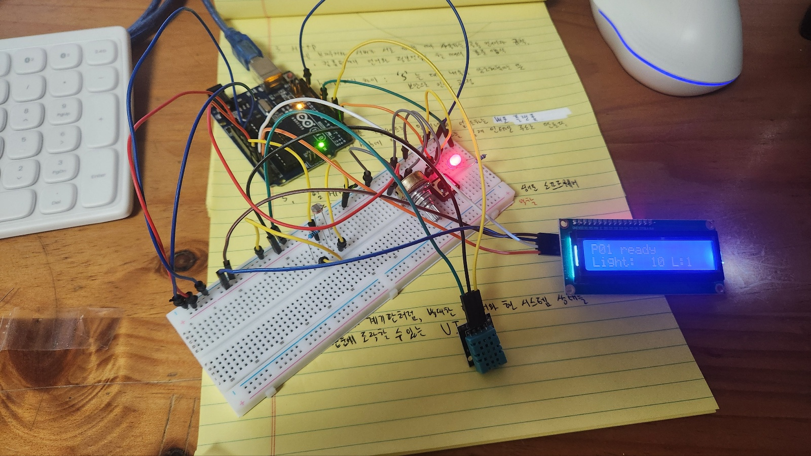

# 학습공간 환경 모니터 (P01 대시보드)

아두이노 UNO에 연결한 센서로 학습공간의 **밝기·온도·습도**를 재고, 웹 화면에서 확인하면서 **조명(LED)을 수동/자동으로 제어**하는 프로젝트입니다.
K-Digital 피지컬AI 과정 실습으로 만들었고, 수업 시연·평가에서 처음 보는 사람이 프로젝터 화면으로 봐도 이해할 수 있게 설계했습니다.



*실제 사용한 회로. LCD 첫 줄은 펌웨어 시작 메시지(`P01 ready`), 둘째 줄은 밝기 원시값과 LED 상태(`L:1` = 켜짐)입니다.*

## 용도

- **목표 과제 3가지**
  1. 지금 학습공간 환경(밝기·온도·습도)을 한눈에 파악하기
  2. 조명 LED를 수동으로 켜고 끄거나, 밝기에 따라 자동으로 켜지게 전환하기
  3. 자동 모드에서 "어둡다/밝다"를 가르는 조도 기준값 바꾸기
- **사용 맥락**: 수업 시연·평가. 강사·동료가 프로젝터 화면으로 보므로 큰 글씨, 색 + 글자 + 아이콘으로 상태를 표시합니다.
- **접근성**: WCAG 2.2 AA 기준을 따릅니다 (아래 표 참고).

## 전체 구조

```
[센서·LED 회로] ─ UNO (firmware/P01) ─USB 시리얼─ bridge/ (Python FastAPI) ─WebSocket·REST─ web/ (브라우저 화면)
                  1초마다 상태를 JSON으로 보냄       COM 포트를 혼자 관리,          http://127.0.0.1:8000
                  PC 명령(LED·AUTO·THRESH) 처리      명령 규칙 검사
```

| 부분 | 하는 일 |
|---|---|
| `firmware/P01/` | 센서를 읽고 LED를 제어합니다. 1초마다 상태를 JSON 한 줄로 PC에 보냅니다. (강사 배포 P01 펌웨어 원본) |
| `bridge/` | PC에서 COM 포트를 혼자 맡아 보드와 대화하고, 웹 화면에 값을 전달합니다. 보드 없이 시험하는 시뮬레이터도 있습니다. |
| `web/` | 빌드 없는 HTML/CSS/JS 대시보드입니다. WebSocket `/ws`로 상태를 받고 `POST /api/command`로 명령을 보냅니다. |

## 회로

아두이노 고급키트 구성품만 사용합니다. 외부 전원이 없으므로 모터·릴레이는 쓰지 않습니다.

### 부품과 역할

| 부품 | UNO 핀 | 역할 | 대시보드에서 |
|---|---|---|---|
| 빨강 LED + 저항 220Ω~1kΩ | D8 | 학습공간 "조명". 저항은 LED에 전류가 너무 많이 흐르지 않게 막습니다. | 수동 켜기/끄기, 자동 모드 |
| 택트 스위치 | D2 | 누름 감지. 내부 풀업(INPUT_PULLUP)을 써서 따로 저항이 필요 없고, 누르면 LOW입니다. | 버튼 눌림 표시 |
| 가변저항 10kΩ | A0 (가운데 다리) | 손으로 돌리는 입력. 위치를 0–1023 값으로 바꿉니다. | 가변저항 값 표시 |
| CdS 조도센서 + 10kΩ | A1 | 밝기 측정. 5V–CdS–(A1)–10kΩ–GND 분압 회로라 **어두울수록 값이 작습니다.** | 밝기 구간, 자동 모드 기준 |
| DHT11 | D4 (DATA) | 온도·습도를 2초마다 측정. 실패하면 "값 없음(null)"으로 보냅니다. | 온도·습도, 환경 경고 |
| LCD1602 (I2C) | A4 (SDA), A5 (SCL) | 보드 자체 화면. PC 없이도 밝기와 LED 상태를 볼 수 있습니다. | "LCD 연결됨" 표시 |

### 전원 연결

UNO의 **5V 핀은 하나**뿐이므로, 5V와 GND를 브레드보드의 한 줄씩에 모아 여러 부품이 나눠 씁니다.

```
UNO 5V  ── [5V 줄] ── 가변저항 한쪽 끝 · CdS 한쪽 다리 · DHT11 VCC · LCD VCC
UNO GND ── [GND 줄] ── 가변저항 다른 쪽 끝 · 10kΩ 아래 다리 · LED − · 버튼 한쪽 · DHT11 GND · LCD GND

D8 ── 저항 ── LED + (긴 다리)          LED − ── GND
D2 ── 버튼 ── GND
A0 ── 가변저항 가운데 다리
A1 ── CdS 다른 쪽 다리 + 10kΩ 위 다리
D4 ── DHT11 DATA
A4 ── LCD SDA,  A5 ── LCD SCL
```

핀 번호는 `firmware/P01/pins.h`와 같고, 바꾸지 않습니다. D0/D1은 USB 통신용이라 비워 둡니다.

## 사이트에서 확인하고 할 수 있는 것

브라우저에서 http://127.0.0.1:8000 을 열면 아래 기능을 쓸 수 있습니다.

### 확인
- **연결 상태**: 화면 위쪽에 브리지·보드 연결 상태(연결됨 / 연결 중 / 다른 회로 / 끊김)를 글자로 표시
- **지금 상태**
  - **밝기**: 어두움 / 보통 / 밝음 구간을 크게, 원시값(0–1023)과 기준선은 작게 표시
  - **온도·습도**: DHT11 측정값. 측정 전·실패는 "값 없음"으로 숫자 0과 구분
  - **조명(LED)**: 보드 프로그램이 보고한 켜짐/꺼짐, 자동 모드 여부
  - **손으로 조작하는 입력**: 가변저항 값, 버튼 눌림 여부
  - **환경 경고**: 온도 상한·습도 하한/상한을 넘으면 글자와 아이콘으로 경고하고 화면 읽기 프로그램에도 알림
- **최근 5분 추이**: 밝기·온도·습도 그래프(전환 가능), **그래프 일시정지**, **30초 간격 값 표**
- **명령 결과**: 보낸 명령이 적용됐는지, 거절됐는지, 응답이 없어 "적용 여부 알 수 없음"인지 기록

### 조작
- **조명 켜기 / 끄기** (수동. 누르면 자동 모드는 해제됨)
- **자동 모드 켜기 / 끄기**: 밝기가 켜는 기준 미만이면 LED를 켜고, 끄는 기준 초과면 끔. 그 사이에서는 상태 유지(깜빡임 방지)
- **모두 정지**: 자동 해제 + LED 끄기
- **밝기 기준 변경**: 켜는 기준 / 끄는 기준(0–1023, 켜는 기준 < 끄는 기준). 기본값 350 / 450
- **경고 기준 변경**: 온도 상한(기본 26°C), 습도 하한(30%) / 상한(70%)

> "적용됨"은 **보드 프로그램이 명령을 처리했다**는 뜻입니다. 실제 LED가 켜졌는지는 눈으로 확인하세요.

## 실행 방법 (Windows)

### 1. 보드에 펌웨어 올리기 (처음 한 번)
1. Arduino IDE에서 `firmware/P01/P01.ino`를 엽니다 (`pins.h`, `protocol.h`가 같은 폴더에 있어야 함).
2. 라이브러리 관리자에서 설치: **DHT sensor library**(Adafruit) 1.4.7, **Adafruit Unified Sensor** 1.1.15, **hd44780**(Bill Perry) 1.3.2
3. 보드 `Arduino Uno`, 포트 선택 → 업로드
   - arduino-cli를 쓴다면: `arduino-cli compile --fqbn arduino:avr:uno firmware/P01` → `arduino-cli upload -p COM4 --fqbn arduino:avr:uno firmware/P01`
4. 시리얼 모니터 115200, 줄 끝 "새 줄" → `1 STATUS` 입력 → `{"v":1,"type":"state","profile":"P01",...}`가 보이면 성공
5. **시리얼 모니터를 닫습니다.** (열려 있으면 대시보드가 포트를 못 엽니다)

### 2. 대시보드 켜기
- `run_board.bat` 더블클릭 → 보이는 COM 포트 중 UNO 번호 입력 → 브라우저가 http://127.0.0.1:8000 을 엽니다.
- 처음 실행 때만 필요한 프로그램(FastAPI 등)을 자동 설치합니다. Python 3.12 이상이 필요합니다.
- 보드 없이 화면만 볼 때는 `run_mock.bat`. 상단에 "시뮬레이션 데이터 · 실제 측정 아님"이 계속 표시되니 발표 기록에 쓰지 마세요.

수동 실행: `cd bridge` → `pip install -r requirements.txt` → `python app.py --port COM5` (또는 `--mock`)

## 배선 점검 팁

실제로 회로를 맞추면서 겪은 문제와 확인 방법입니다.

| 증상 | 원인일 수 있는 것 |
|---|---|
| 가변저항·밝기 값이 손잡이와 상관없이 0 근처 | 브레드보드 5V 줄에 UNO 5V가 안 들어옴. 긴 브레드보드는 **전원 레일이 가운데에서 끊긴 제품**이 있으니 확인 |
| 두 아날로그 값이 늘 똑같이 나옴 | 핀이 떠 있거나(연결 안 됨) A0·A1 선이 같은 줄에 꽂힘 |
| 버튼을 누르면 LED·센서 값이 같이 변함 | GND 줄이 실제 UNO GND와 안 이어짐 (버튼은 D2와 GND만 연결해야 함) |
| LCD 백라이트가 꺼져 있음 / "LCD 연결 안 됨" | LCD VCC에 5V가 없음. 펌웨어는 **보드가 켜질 때 한 번만** LCD를 확인하므로 배선을 고친 뒤 USB를 다시 꽂기 |
| 겉보기 멀쩡한데 연결이 안 됨 | 점퍼선 내부 단선. 다른 선으로 바꿔 보기 |

- 미니 브레드보드는 한 줄에 서로 연결된 구멍이 5개뿐이고, 가운데 홈을 넘으면 끊깁니다.
- 배선을 바꿀 때는 USB를 뽑고, 5V와 GND가 같은 줄에 들어가지 않게 합니다.

## 보드 통신 규약 (강사 배포 P01 펌웨어 그대로)

| 방향 | 내용 |
|---|---|
| 보드→PC | 1초마다 `{"type":"state","profile":"P01","pot_raw","light_raw","button_pressed","led","auto","lcd_ready","temperature_c","humidity_pct"}` |
| PC→보드 | `요청번호 명령 인수` 형식. `STATUS`, `PING`, `LED 0/1`, `AUTO 0/1`, `THRESH 켜기 끄기`(0–1023, 켜기<끄기), `STOP` |
| 응답 | `ack`(보드 프로그램이 적용) / `error` |

- USB 시리얼 115200, 줄 끝 LF.
- 펌웨어는 THRESH 값을 state에 넣지 않습니다. 브리지는 마지막으로 적용한 값을 기억하고, 보드 재시작(ms 감소)을 감지하면 시작값 350/450으로 되돌립니다.

## 안전·정확성 규칙

- 연결 직후 2초 대기 → `STATUS`로 P01 확인. 다른 회로면 명령을 막습니다.
- 명령은 한 번에 하나. 3초 안에 응답이 없으면 "적용 여부 알 수 없음"으로 표시하고 **자동 재전송하지 않습니다.**
- 마지막 값이 3초보다 오래되면 "오래됨", 브리지·보드가 끊기면 "연결 끊김"으로 표시하고 조작을 막습니다. 출력이 꺼졌다고 추정하지 않습니다.
- `null`(DHT 측정 전·실패)은 "값 없음"으로, 실제 숫자 0과 구분합니다.
- 시뮬레이션 값은 실제 측정처럼 기록·발표하지 않습니다.
- 브리지는 기본으로 `127.0.0.1`에서만 열립니다(같은 PC 전용).

## 접근성 (WCAG 2.2 AA 대응 내역)

| 기준 | 구현 |
|---|---|
| 1.4.1 색 사용 | 연결 상태·밝기 구간·경고에 글자와 아이콘을 함께 사용 |
| 1.4.3 / 1.4.11 대비 | 라이트·다크 모두 글자 4.5:1, 경계·그래프 선 3:1 이상 (토큰 검사) |
| 1.4.10 리플로우 | 375px 폭에서 가로 스크롤 없음 |
| 1.1.1 대체 텍스트 | 그래프 `desc`에 최소·최대·현재값, 30초 간격 표 제공 |
| 2.1.1 / 2.4.7 키보드·포커스 | 모든 조작 키보드 가능, 3px 포커스 테두리, 건너뛰기 링크 |
| 2.4.11 포커스 가림 없음 | 고정 헤더 없음 |
| 2.2.2 일시정지 | 그래프 일시정지 버튼 |
| 2.5.8 타깃 크기 | 버튼 최소 44–48px |
| 3.3.1 / 3.3.3 오류 안내 | 기준값 오류를 해당 칸 아래에 원인과 고치는 방법으로 표시, 첫 오류 칸으로 포커스 |
| 4.1.2 이름·역할·값 | 자동 모드는 `role="switch"` + `aria-checked`(보드 보고값 기준) |
| 4.1.3 상태 메시지 | 명령 결과·경고 발생/해제를 `aria-live`로 알림 |

자동 검사는 시작점일 뿐입니다. 발표 전에 키보드만으로 세 과제(상태 읽기, 자동 모드 켜기, 기준 변경)를 해 보고, 가능하면 NVDA로 한 번 들어 보세요.

## 폴더 구성

```
firmware/P01/   P01.ino · pins.h(핀 배치) · protocol.h(통신 규약) — 강사 배포 원본 사본(SHA-256 대조함)
bridge/         app.py(웹 서버) · board_link.py(포트 관리) · protocol.py(규약 검사) · mock_board.py(시뮬레이터)
web/            index.html · styles.css · app.js
tools/          pty_board.py — 가상 시리얼 포트 시험 도구 (Linux/macOS, --drop LED / --profile P02)
docs/           circuit-photo.jpg — 실제 회로 사진
run_board.bat   실물 보드로 실행
run_mock.bat    시뮬레이션으로 실행
```
